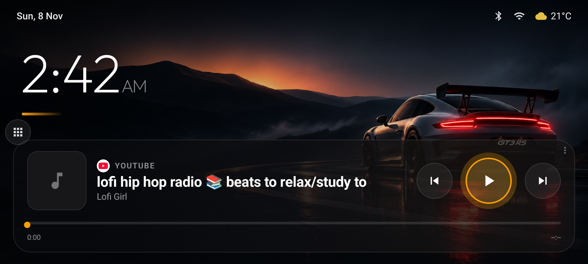
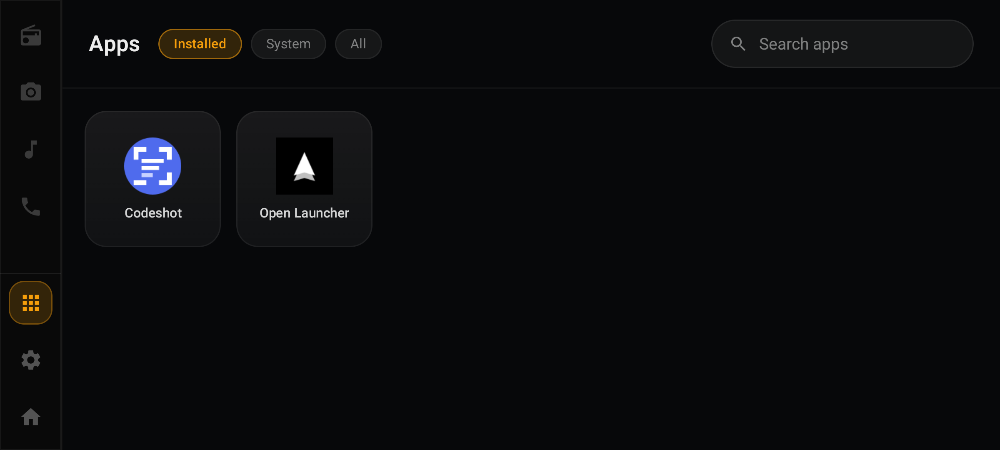
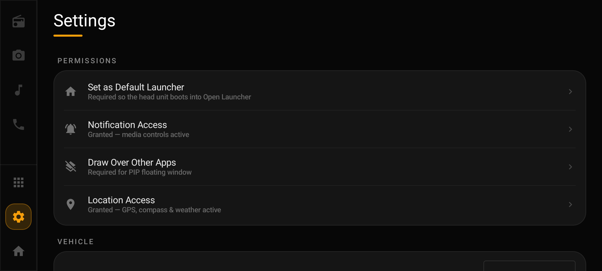

<div align="center">

# GT3 RS Car Launcher

**A cinematic, amber-glass Android launcher for aftermarket car head units.**

Dark, offline-first, and built to look like it belongs in the dashboard.

[](#-license)




</div>

---

## ✨ Overview

A custom redesign of a car head-unit launcher with a **Porsche GT3 RS** theme:
a full-bleed cinematic wallpaper, a large thin clock, and a glassy media player —
all in a warm **amber** accent over deep black.

- **Cinematic home** — GT3 RS wallpaper edge-to-edge, with a legibility scrim.
- **Big clock** — thin geometric *Outfit* type with an amber underline, 12-hour with AM/PM.
- **Status bar** — date, Bluetooth, Wi-Fi, cellular, and live weather + temperature.
- **Glass media player** — mirrors *any* Android media session (Spotify, YouTube, etc.):
  live **source badge** (the playing app's real icon + name), album art, title/artist,
  an **amber-glowing play button**, and an amber progress bar with a scrub thumb.
- **Rail-free home** — the nav rail is hidden on the home screen to match the design;
  a subtle apps handle opens the drawer.
- **Themed throughout** — the app drawer and settings share the dark-glass + amber language.
- **Offline-first** — the dashboard works without a connection; weather simply hides when offline.

Typography: **Outfit** (clock) + **Plus Jakarta Sans** (UI), bundled as variable fonts.

---

## 📸 Screenshots

| App drawer | Settings |
|---|---|
|  |  |

---

## 🧩 Widgets & features

Beyond the home layout, the underlying launcher ships a library of car-oriented widgets
you can enable and arrange:

- **Media / Now-Playing** and a real-tuner **AM/FM radio** deck (MCU or via a radio app's session)
- **GPS speedometer**, **compass**, **altimeter**, **trip meter** (all offline)
- **Head-unit vitals** (CPU / memory / temperature)
- **Soundboard** with assignable pads
- Customizable **accent color**, **font**, **wallpaper**, units, and day/night mode

---

## 🔧 Build

Requirements: Android Studio (recent), JDK 17+, Android SDK 36.

```bash
git clone https://github.com/Akhilvrm/gt3rs-car-launcher.git
cd gt3rs-car-launcher
./gradlew assembleDebug
```

The APK is produced at `app/build/outputs/apk/debug/app-debug.apk`.
A prebuilt debug APK is also attached to the latest [release](../../releases).

## 📲 Install on a head unit

1. Copy the APK to the unit, or `adb install app-debug.apk`.
2. Enable **Install unknown apps** for your file manager.
3. Open the app and grant:
   - **Notification access** → the media player (Spotify, etc.)
   - **Location** → weather + compass
4. Press Home and set this launcher as the default.

---

## 🙏 Credits

Built on the open-source **[openlauncher](https://github.com/dw2lam/openlauncher)** project by dw2lam (MIT),
with the UI redesigned around the GT3 RS theme (home layout, media card, typography, palette, app drawer and settings).

## 📄 License

MIT — see the upstream project. You're free to use, modify, and distribute.
